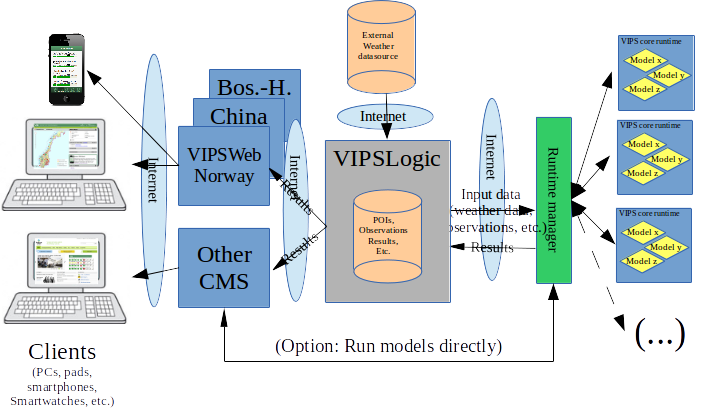

# VIPSCore

V. 2026-11-23

This is the server component that hosts the models. It is accessible via VIPSCoreManager over http/REST. Models that are on the component's classpath
are autodetected, indexed and made available through the REST service. The service is used by
[VIPSLogic](https://gitlab.nibio.no/VIPS/VIPSLogic) when running models. It can also be contacted directly by any client.

VIPSCore is a part of the [VIPS platform for automatic pest prediction](https://gitlab.nibio.no/VIPS/documentation)

## VIPSCoreManager

[VIPSCoreManager](https://gitlab.nibio.no/VIPS/VIPSCoreManager) is a layer in front of VIPSCore that handles authentication of clients and logging of usage. All services available in VIPSLogic are transparently accessible via VIPSCoreManager. Add this layer if you want to limit and log usage, and also if you want to set up e.g. scaling of VIPSCore instances.



## Build and deploy

Clone [the code](https://gitlab.nibio.no/VIPS/VIPSCore):

```
$ git clone git@gitlab.nibio.no:VIPS/VIPSCore.git
```

The project includes [maven-wrapper](https://maven.apache.org/wrapper/), which means that you do not need Maven installed locally. Build using the wrapper script with the following command

```
$ ./mvnw clean install
```

or on Windows

```
$ mvnw.cmd clean install
```

**PLEASE NOTE that this builds the package without any models. See "Adding models" below for more information**

Download and install [WildFly](https://www.wildfly.org/) == 34.0.1

Deploy the build from this project in Wildfly.

Wildfly should run on Java >= 17

### Adding models

Models are listed as dependencies in the POM and built into the WARfile. In order to make it possible
to configure your own set of models to include, we have separated the model dependencies out in a
separate file. The default is `models.xml`, and contains the models that VIPS in Norway are using
currently.

To build the package with the default set of models, run

```bash
$ build_with_models.py
```

To build with your preferred set of models, create a new file called e.g. `my_models.xml` and run

```bash
$ build_with_models.py my_models.xml
```

To create Maven `<dependencies/>` XML with the latest versions of all models on NIBIO's GitLab, use the `build_models_xml.py` script, like this:

```bash
# Write latest production version dependency elements XML to my_models.xml
$ ./build_models_xml.py > my_models.xml

# Write latest SNAPSHOT version dependency elements XML to my_models.xml
$ ./build_models_xml.py -s > my_models.xml

```

## Implement a model

See [implement_model.md](./docs/implement_model.md)

## Create client for a model

See [create_client.md](./docs/create_client.md)
