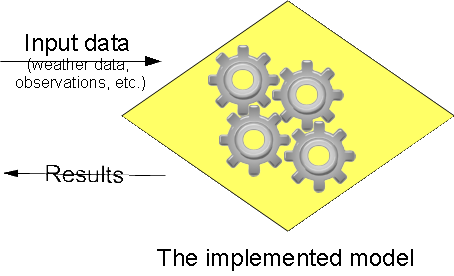
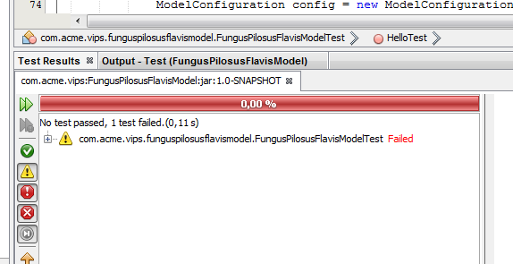
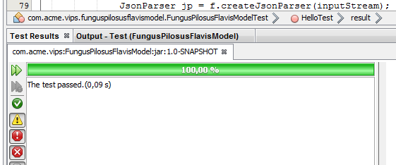

# A step-by-step introduction to implementing prediction models in VIPS

Tor-Einar Skog, Senior developer, NIBIO

Updated: 2022-08-30


## What you will learn
This document describes how to implement and test a forecasting model that can be used on the VIPS platform.

Prerequisites
* You should be familiar with how the VIPS system works. It is recommended that you read the [VIPS introduction](https://gitlab.nibio.no/VIPS/documentation)
* You should have a basic understanding of the Java programming language. 
* You should be somewhat familiar with NetBeans, or use another IDE that your’re familiar with, just bear in mind that some of the instructions may be irrelevant to you in that case.
* For model implementation in [R](https://www.r-project.org/) or [Python](https://www.python.org/) (**currently not recommended**), familiarity with the language at hand is of course recommended
* You need the library VIPSCommon (a file called VIPSCommon-2022.1.jar) somewhere on your local computer. You can clone and build it from here: https://gitlab.nibio.no/VIPS/VIPSCommon 
* You need the example NetBeans project «FungusPilosusFlavisModel» somewhere on your local computer. You can clone it from our GitLab: https://gitlab.nibio.no/VIPS/test/funguspilosusflavismodel 

## Model design in VIPS
### The structure of a model



A model is conceptually illustrated above. You have a set of input data in some form, you have the analysis/algorithms happening inside the model, and the model returns a set of results. In VIPS, certain design requirements must be met:
* The model must be programmed in Java or another language that can run on the Java Virtual Machine. This includes R and Python (**only 2.7, not recommended**)
* The model must implement an interface (a design contract)
* The model must be packaged as a JAR (Java Archive) file
* The input data must be in a specific format (details below)
* Results must be returned in a specific format (details below)
* The model must provide its own description and usage information in at least English and aditionally in any preferred language

When a model meets these requirements, it can be deployed to the VIPS Core runtime server and be made available without any more configuration. The model can be called over HTTP/REST from any authenticated client on the Internet. In order to set up batch jobs (running at regular intervals) in the VIPS admin, some configuration classes need to be added to the VIPSLogic system, which acts as an authenticated client.

## Developing a model
What you need to develop a VIPS model is:
* A decent coding environment (IDE) like [NetBeans](https://netbeans.apache.org/), [Eclipse](https://www.eclipse.org/) or [IntelliJ](https://www.jetbrains.com/idea/).
* A library of VIPS classes called VIPSCommon.jar
* A testing framework like [Junit](https://junit.org/). This is normally bundled with your IDE (see above)

The normal workflow is that you have some correctly formatted (see other documentation) weather data in a file that you put on the project’s classpath, you mix this with the other configuration data and develop the model based on these input data. You must have one main class that implements the Model interface, which is available in the VIPSCommon.jar library. The test framework can be used to test single methods that are part of the algorithms or you can test the complete model.

When you’re happy with how the model works you can test deploy it to the VIPSCore server (TODO: Document this)

## Implementing a forecasting model step-by-step
In this project, we are going to implement a forecasting model for a virtual fungus called «Fungus pilosus flavis» (please bear with me, any phytopatologists who might read this). Let's say that it there is a forecasting model for it that states that 
* There is no infection risk until you have reached 500 day degrees (Celcius)
* After that, the risk multiplies by 2 for each consecutive hour of leaf wetness (starting at 1 on the first hour). When reaching the threshold of 24, there is serious risk of infection, and measures should be taken.

We’ll be using NetBeans IDE for this example, but the process should be transferable to other IDEs. NetBeans can be downloaded from here: https://netbeans.apache.org/download/ Select either the Java EE version or the one with everything. Follow the install instructions and start Netbeans.

## Creating a new NetBeans project for the forecasting model
1. Start the NetBeans application and remove the «Start Page». Select `File -> New Project` and select project type `Java Application`. Put it somewhere that you’ll remember. 
2. NetBeans sets up the project structure for you, but you should create a package. Right click `Source Packages` and select `New -> Java Package`. Name it whatever you want, e.g. `com.acme.vips.funguspilosusflavis`
3. Create the main model class: Right click on the package and select `New -> Java Class`. Name it e.g. `FungusPilosusFlavisModel`
4. The next thing you should do is to add the basic dependencency for the model: The library called VIPSCommon. Right click on `Libraries` and select `Add JAR/Folder`. Locate the file (it should be included with this documentation) and add it.

Now you should be ready to code.

## Working on the model class

1. To make sure that the file is compliant with the VIPS Model specifications, change this

    ```java
    public class FungusPilosusFlavisModel {
    ```
    to this
    ```java
    public class FungusPilosusFlavisModel implements Model{
    ```
2. NetBeans complains. Click on the light bulb that pops up in the gutter, and select `Add import for no.bioforsk.vips.model.Model`
3. NetBeans complains again. Click on the light bulb and select `Implement all abstract methods`
4. NetBeans creates all the methods that are part of the Model interface. Please note that these methods at the moment do not do anything, except cause an error (throw an UnsupportedOperationException) if they are called. The implementation of the methods is entirely up to you.

Now the class is ready to be programmed and do some calculations.

## Create the method for finding when 500 day degrees has been passed
To find out when 500 day degrees (since some date) have passed, you need the mean temperature of each day. All weather observations in VIPS are represented by an instance of the object WeatherObservation. This object has a few important properties:
* `ElementMeasurementTypeId`: Rain, mean temperature, leaf wetness etc.
* `TimeMeasured`
* `LogInterval`: Hourly, Daily, Monthly measurement
* `Value`: the numerical value of the weather observation

We need a list of one WeatherObservation with mean temperature per day. So we could start by writing this method:

```java
public Date getDateWhenDayDegreeLimitHasPassed(List<WeatherObservation> observations)
{
}
```

NetBeans complains, because it can't find the definition of `WeatherObservation`. Click on the light bulb and select `Add import for no.bioforsk.vips.entity.WeatherObservation`, and then `Add import for java.util.Date`). NetBeans still complains, but that's because the method does not return anything yet. So a simple approach could be:

1. Loop through all the `WeatherObservation` objects, and add the value to the total day degree sum as we do so
2. When the threshold of 500 has been reached, return the date of that `WeatherObservation` object.

Sample code for this could be:
```java
public Date getDateWhenDayDegreeLimitHasPassed(List<WeatherObservation> observations){

// Make sure the observations are in chronological order
Collections.sort(observations);
// Initalize the day degree counter
Double dayDegrees = 0.0;
// Iterate through the list of observations
for(WeatherObservation obs:observations)
{
    // Make sure it's only daily temperature observations that are used
    if(obs.getLogIntervalId()
            .equals(WeatherObservation.LOG_INTERVAL_ID_1D) 
        && obs.getElementMeasurementTypeId()
            .equals(WeatherElements.TEMPERATURE_MEAN))
    {
        // Add to dayDegree sum
        dayDegrees += obs.getValue();
        // If threshold is reached, return the date of the current temperature
        // measurement
        if(dayDegrees >= 500.0)
        {
            return obs.getTimeMeasured();
        }
    }
}
// We have finished looping through the observations, and dayDegrees has
// not passed 500. So we can't return a Date, we must return NULL (nothing)
return null; 
}
```

## Creating the method to calculate the infection risk
We can operate on hourly weather data for leaf wetness and calculate the infection risk. Data in will be a list of weather observations (leaf wetness, hourly). Output data will be a dictionary with timestamp as key, and the infection risk as value. So for instance for 24th July 2014 14:00 UTC there will be only one value.

An example of a solution can be:

```java
public Map<Date, Integer> getInfectionRisk(List<WeatherObservation> observations)
{
    // Create the map with dates and infection risk values
    Map<Date, Integer> riskMap = new HashMap<>();
    // Make sure the observations are in chronological order
    Collections.sort(observations);
    // Counter for consecutive hours of leaf wetness
    Integer consecutiveHoursOfLeafWetness = 0;
    // Loop through the list of observations
    for(WeatherObservation obs:observations)
    {
        // We define a lower threshold for leaf wetnes to be 10mins/hour
        if(obs.getValue() > 10.0)
        {
            // Leaf wetness registered, add to consecutive hours counter
            consecutiveHoursOfLeafWetness++;
        }
        else
        {
            // No leaf wetness, reset counter
            consecutiveHoursOfLeafWetness = 0;
        }
        
        // We set the risk value
        riskMap.put(obs.getTimeMeasured(), consecutiveHoursOfLeafWetness * 2);
    }
    // Return the map with all values
    return riskMap;
}
```

## How can we be sure that these methods work? Testing to the rescue!
In order to ensure that the methods work, we should test them. Ok, maybe these methods are so simple that they do not need testing. But in most models you will have complex calculations, and for that you need testing to ensure correctness. 

For Java, the most common method is to use a testing framework called Junit (which is part of a larger family of testing frameworks for different programming languages called «xUnit», see: http://en.wikipedia.org/wiki/XUnit). To set up a test for the model class, right click on it (In the `Projects` tab and select `Tools -> Create/Update tests`. Click OK in the dialog box. A test class is created for you, and all public methods in the model class have gotten their corresponding test methods.  When you run the test, which you can do by right clicking the model class and select `Test File` or just hit `[CTRL-F6]`, you will see that all tests fail. This is by design. It’s now up to you to select which test methods to keep.

A weather data file is included in the documentation. Copy this into the `test` folder

## How testing works in JUnit 
Let's begin with writing a very simple test method:

```java
@Test
public void HelloTest()
{
    String expected = "Hello Test!";
    String result = "HellOOO Test!";
    
    Assert.assertEquals(expected,result);
}
```

The method has `@Test` before the declaration. This is a so called annotation, which helps JUnit find which methods in the class are actually meant to be methods to run during a test. The test consists of two string variables (expected and result). These variables are asserted (or expected) to be equal, and this is tested using the `Assert.assertEquals` method in JUnit. Of course the two strings are not equal, so the test will fail. You can try that by simply entering the key combination `[ALT]+[F6]`, which runs all tests for the current project. You should see this in the lower part of NetBeans:



Now you can try to make the test pass. You can do that by setting the strings to have the same value. Run the test again (`[ALT]+[F6]`), then you should see that the test passes:



So now we can add a test for one of the methods that we created in the `FungusPilosusFlavisModel` class. Let's start with testing if `getDateWhenDayDegreeLimitHasPassed` can find the correct date for when we have passed 500 day degrees. We use the data from the file `JSONWeatherdata.json` (you'll find it under `Other Test Sources`). These data are quite easy to import into a spreadsheet. By doing that, you can add the temperatures, and find that at July 8th 2012, the day degrees have reached a value of 509.5. So we can test this in the following way.

```java
@Test
public void canFindDateWhenDayDegreeLimitPassed()
{
    FungusPilosusFlavisModel instance = new FungusPilosusFlavisModel();
    // We create the expected date
    Calendar cal = Calendar.getInstance(TimeZone.getTimeZone("Europe/Oslo"));
    cal.set(2012, Calendar.JULY, 8, 0, 0, 0);
    cal.set(Calendar.MILLISECOND, 0);
    Date expected = cal.getTime();
    ModelConfiguration config = new WeatherDataFileReader().getModelConfigurationWithWeatherData("/JSONWeatherData.json", "FUNGUSPILO");
    List<WeatherObservation> observations = (List<WeatherObservation>)config.getConfigParameter("observations");
    Date result = instance.getDateWhenDayDegreeLimitHasPassed(observations);
    
    assertEquals(expected,result);
}
```

If you run the tests now, you'll (hopefully) see that both tests passed. Both tests? Yes, you have two tests: 

* `helloTest`
* `canFindDateWhenDayDegreeLimitPassed`

Each time you change the program and compile it, these tests are run. This means that if you change something in the program (either intentionally or unintentionally) that makes these tests fail, **you will be informed**. This might not seem so relevant for such a simple program, but believe me, it will save your day when the code gets big and ugly. Also, writing tests helps you think of how the program works. If you write the tests first, you will think more clearly about the problem, in my experience.

**Exercise: Write a test for getInfectionRisk()**

## Putting it together
We now have the most important methods created (and successfully tested). What we need to do now is to get data in (set configuration, get weather data etc) and get the results out in the expected format.

### Data in
Input data are sendt in a large lump called a `ModelConfiguration`. It's a key based store of many different kind of objects, in principle almost any Java object: Numbers, strings, dates, WeatherObservations. This configuration object is sent to the model through the method setConfiguration. So to get the weather data, we need to extract them from the configuration object in that method. An example of how to do this is as follows:

First, at the top of the class, declare the object that holds the weather data:

```java
List<WeatherObservation> observations;
```

This list will stay empty (`null`) until `setConfiguration` does something about it. So let's do that, e.g.:

```java
@Override
public void setConfiguration(ModelConfiguration config) throws ConfigValidationException {
    // We use an object mapper, because we don't know if the objects inside
    // the ModelConfiguration are simply instances of HashMaps or instances
    // of proper classes. Usually (when sent over the wire using REST), they 
    // are the former.
    ObjectMapper mapper = new ObjectMapper();
    // Get the observation list
    this.observations = mapper.convertValue(config.getConfigParameter("observations"), new TypeReference<List<WeatherObservation>>(){});
    // After this we should do validation of the data, but that's for another lesson
}
```

So now we have the weather data in a list, and we can start using them

### Data out
Data out are sent as a list of `Result` objects. The method to get the data is called `getResult()`, surprisingly. An example of this method could be:

```java
 @Override
public List<Result> getResult() throws ModelExcecutionException {
    // Initialize the list of results
    List<Result> results = new ArrayList<>();
    // Ensure that the observations are in chronoligical order
    Collections.sort(this.observations);
    // Which date did day degree sum exceed 500?
    Date dayDegreeLimitReachedDate = this.getDateWhenDayDegreeLimitHasPassed(this.observations);
    // Get infection risk for the whole period
    Map<Date, Integer> uncontrolledInfectionRisk = this.getInfectionRisk(this.observations);
    // Get all dates from the map of infection risk
    List<Date> dateList = new ArrayList(uncontrolledInfectionRisk.keySet());
    Collections.sort(dateList);
    // Loop through dates
    for(Date currentDate:dateList)
    {
        // Create a new result object
        Result result = new ResultImpl();
        // Set the timestamp on it
        result.setResultValidTime(currentDate);
        // If we're after the date of day degree sum > 500, use the infection risk
        if(currentDate.compareTo(dayDegreeLimitReachedDate) >= 0)
        {
            // Set infection risk
            result.setValue(this.getModelId().toString(), FungusPilosusFlavisModel.CONTROLLED_INFECTION_RISK, uncontrolledInfectionRisk.get(currentDate).toString());
        }
        else
        {
            // Set infection risk to 0
            result.setValue(this.getModelId().toString(), FungusPilosusFlavisModel.CONTROLLED_INFECTION_RISK, "0");
        }
    // Set the warning status
    // If controlled infection risk < 64, status is NO RISK
    // Otherwise it’s HIGH RISK
    result.setWarningStatus(uncontrolledInfectionRisk.get(currentDate) < 64 ? Result.WARNING_STATUS_NO_RISK : Result.WARNING_STATUS_HIGH_RISK);
        // Add result to list
        results.add(result);
    }
    // We're done!
    return results;
}
```

Netbeans will complain, because you haven't defined the global constant `CONTROLLED_INFECTION_RISK`. You can define it at the top of the class:

```java
public final static String CONTROLLED_INFECTION_RISK = "CONTROLLED_INFECTION_RISK";
```

How do we know that `getResult()` works? Let's test it! We can start with writing this test method:

```java
@Test
public void modelWorksAsExpected()
{
    try {
        FungusPilosusFlavisModel instance = new FungusPilosusFlavisModel();
        // Get weather observations from file
        ModelConfiguration config = this.getConfiguration("/JSONWeatherData.json");
        instance.setConfiguration(config);
        List<Result> results = instance.getResult();
    } catch (ConfigValidationException | ModelExcecutionException ex) {
        fail(ex.getMessage());
    }
}
```

This test does not (yet) test the results, it only tests that the method doesn't fail when run. If you try to run the tests, you'll see that it actually fails. This is because the method getModelId() has not been implemented correctly. Fix that by adding the `modelId` to the class (at the top):

```java
public final static ModelId modelId = new ModelId("FUNGUSPILO");
```

The string `"FUNGUSPILO"` is now the unique ID for this model. The ID must be a string of 10 characters. It could be anything (as long as it's 10 characters long), but it's recommended that it is some sort of abbreviation that gives a human reader a clue about which model it is.

Running the test again should make all tests pass.

One behavior that could be tested, is that the infection risk is always 0 and the warning status == LOW when the result is from before the day when day degree sum exceeds 500. We put that into our test:

```java
@Test
    public void modelWorksAsExpected()
    {
        try {
            FungusPilosusFlavisModel instance = new FungusPilosusFlavisModel();
            // Get weather observations from file
            ModelConfiguration config = this.getConfiguration("/JSONWeatherData.json");
            instance.setConfiguration(config);
            List<WeatherObservation> observations = (List<WeatherObservation>)config.getConfigParameter("observations");
            Date dayDegreeLimit = instance.getDateWhenDayDegreeLimitHasPassed(observations);

            // ***********************
            // Check that all results before date for day degree limit are zero
            List<Result> results = instance.getResult();
            for(Result result:results)
            {
                if(result.getResultValidTime().compareTo(dayDegreeLimit) <= 0)
                {
                    Assert.assertEquals(
                            "0", 
                            result.getValue(FungusPilosusFlavisModel.modelId.toString(), FungusPilosusFlavisModel.CONTROLLED_INFECTION_RISK)
                    );
                    Assert.assertEquals(Result.WARNING_STATUS_NO_RISK, result.getWarningStatus());
                }
            }
            // **************************
            
        } catch (ConfigValidationException | ModelExcecutionException ex) {
            fail(ex.getMessage());
        }
    }
```

**Exercise: Write a test (or add to the one above) that checks that the infection risk is calculated correctly after the day when day degree sum exceeds 500.**

###Implementing the meta information methods
So, now you have a forecasting model that produces the expected results. When this model is deployed to the VIPS core runtime, it is discovered automatically and added to the list of available models. In order for other systems (like VIPSLogic or another client) to be able to query and show information about the model, it needs to implement the methods that provide documentation:

* `getModelName()` - the name of the model. For instance «Fungus pilosus flavis model»
* `getLicense()`  - Open Source? Proprietary? Your pick
* `getCopyright()` - For instance «(c) 2014 NIBIO»
* `getModelDescription()` - Detailed description of how the model works, from a biological perspective
* `getModelUsage()` - How to configure the model (what parameters are needed, what values may they have and so on) 
* `getSampleConfig()` - A sample Json configuration file.

Most of these methods have two versions: One takes language into account, one doesn't. Translation in model documentation is part of a presently unwritten chapter. For now, you can do this if you want as a general pattern:

```java
@Override
public String getModelName() {
    return this.getModelName(Model.DEFAULT_LANGUAGE);
}

@Override
public String getModelName(String language) {
    return "Fungus pilosus flavis model";
}
```

This way you only need to change the implementation one place, in the language dependent method.

## Learning from an existing model's code
So far we have done the very basics of the most important parts of the model implementation. There's a lot more to it than this. For further study, we recommend that you take a look at the version of NIBIO's forecasting model for apple scab. You can find it here: https://gitlab.nibio.no/VIPS/Model_APPLESCABM

## Even more functionality
### Translation utilities
You can extend the `no.nibio.vips.i18n.I18nImpl` class for easy translation of text that the class provides.  In that case, provide a set of properties files (which makes up a resource bundle) that you can specify in the model constructor, e.g. like this:

```java
public AppleScabModel()
{
    // Setting the file name of the resource bundle
    super("no.nibio.vips.model.applescabmodel.texts");
    this.weatherUtil = new WeatherUtil();
    this.modelUtil = new ModelUtil();
}
```

NetBeans has good support for this, read more about resource bundles here https://docs.oracle.com/javase/tutorial/i18n/resbundle/concept.html 

To get a translation from the resource bundles, follow this example:

```java
@Override
public String getModelName() {
    return this.getModelName(Model.DEFAULT_LANGUAGE);
}

@Override
public String getModelName(String language) {
    return this.getText("name", language);
}
```

### Including images in the description
You can include images in the description text for the model. The images are embedded to the text as `` tags with the image base64 encoded inside the `src`-attribute. For instance:

```html

```

The `` tags are created from template tags that you insert into the document. These tags look like this:

```
{{filename="/path/to/filename.jpg" description="Sample description" float="[CSSFloat property]"}}
```

The path is relative to the path in your jarfile.

To enable this functionality, use the `ModelUtil` class from VIPSCommon. For instance like this:

```java
@Override
public String getModelDescription(String language) {
    try
    {
        return this.modelUtil.getTextWithBase64EncodedImages(this.getText("description", language), this.getClass());
    }
    catch(IOException ex)
    {
        return this.getText("description", language);
    }
}
```

## Implementing models using R
Renjin is a JVM implementation of R, which makes it possible to run R scripts on the JVM and pass data between Java and R. Read more here: http://www.renjin.org/ 

This has been done successfully in the Leaf blotch model: https://gitlab.nibio.no/VIPS/model_leafblotch Please use this as a reference for how to do it

## Implementing models using Python **(currently not recommended)**
**Please note that Jython only supports Python 2.7 at the moment. (2022-08-30).** Another alternative is using GraalVM, but the Python support and how to integrate it is in an early stage. **At the moment, we do not recommend writing models using Python.**

We’re using Jython to accomplish this. Read more about Jython here: http://www.jython.org/ . 

The basic approach is that you create a model Java class and a corresponding Python class, and you forward all calls to the Java class methods to the corresponding Python class methods. How to do it is documented here: http://www.jython.org/jythonbook/en/1.0/JythonAndJavaIntegration.html#more-efficient-version-of-loosely-coupled-object-factory . The nuts and bolts of this are however implemented in VIPSCommon, so following the instructions below should work.

Create your project the same way as before, add VIPSCommon to your libraries, as well as Jackson-Core. You must also add Jython standalone jar to your dependencies. Download from here: http://www.jython.org/downloads.html 

Your model class must extend the JythonModel abstract class: 

```java
public class FungusPilosusFlavisModel extends JythonModel {
```

The Python modules **must be placed in a folder called «python» under «Source Packages»**, e.g. like this:

**-->TODO ADD ILLUSTRATION<--**

You should instantiate the Python model like this:

```java
private final Model pythonModel;
    
public class FungusPilosusFlavisModel extends JythonModel{
    
    private final Model pythonModel;
    
    public FungusPilosusFlavisModel()
    {
        super();
        pythonModel = this.getPythonModel("FungusPilosusFlavisModel", "FungusPilosusFlavisModel");
    }
```

The first string in the `getPythonModel` call is the relative path to your module. In our example this is just the file name, since the file is placed directly under the /python folder. The second string is the name of the python Class inside the module.

The Python Class itself must implement the Model interface, so it starts something like this:

```python
from no.nibio.vips.model import Model

class FungusPilosusFlavisModel(Model):

    def getModelName(self):
        return "FungusPilosusFlavisModel"
```

```java
The corresponding code in the Java class would be: 
@Override
public String getModelName() {
    return this.pythonModel.getModelName();
}
```

In the Python class, you only need to implement the Model interface’s methods that you’re actually going to use there. If you’re fine with e.g. returning the model name directly from the Java class method, you can do so and omit the declaration in the Python class.

### Testing
Create the test class like before, you test the Java Class that calls the Python Class

### Example
The FungusPilosusFlavis sample model has been implemented successfully using this approach. The NetBeans project should be included with this documentation.

